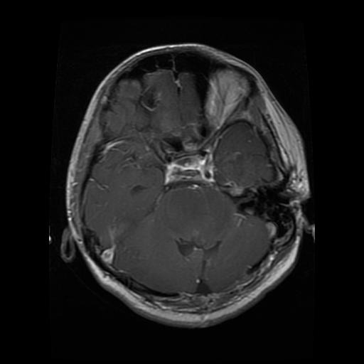

# ML Pupils - Brain Tumor Classification

[](https://www.python.org/)
[](LICENSE)
[](https://github.com/thaiquangphat/ml-pupils/graphs/contributors)
[](https://github.com/thaiquangphat/ml-pupils/issues)
[](https://github.com/thaiquangphat/ml-pupils/network/members)
[](https://github.com/thaiquangphat/ml-pupils/stargazers)

<div align="center">
  
  <br>
  <em>Example of brain tumor MRI scan from the dataset</em>
</div>

## Project Overview

This project implements and compares multiple machine learning models for classifying brain tumor MRI images. The dataset used is the [Brain Tumor MRI Dataset](https://www.kaggle.com/datasets/masoudnickparvar/brain-tumor-mri-dataset) from Kaggle, which contains MRI scans of different types of brain tumors.

### Project Goals

- Implement and compare various machine learning models for brain tumor classification
- Analyze model performance using multiple metrics (accuracy, precision, recall, F1-score)
- Provide insights into the strengths and limitations of different approaches
- Create a comprehensive documentation of the implementation process

## Implemented Models

The project implements the following models, each in its own directory under `src/models/`. Click on each model to view its detailed documentation:

| Model | Directory | Documentation |
|-------|-----------|---------------|
| Artificial Neural Network (ANN) | [src/models/ann/](src/models/ann/) | [ANN Docs](docs/models.md#artificial-neural-network-ann) |
| Decision Tree | [src/models/decision_tree/](src/models/decision_tree/) | [Decision Tree Docs](docs/models.md#decision-tree) |
| Naive Bayes | [src/models/naive_bayes/](src/models/naive_bayes/) | [Naive Bayes Docs](docs/models.md#naive-bayesian) |
| Bayesian Network | [src/models/bayes_net/](src/models/bayes_net/) | [Bayesian Network Docs](docs/models.md#bayesian-network) |
| Hidden Markov Model (HMM) | [src/models/hmm/](src/models/hmm/) | [HMM Docs](docs/models.md#hidden-markov-model) |
| Support Vector Machine (SVM) | [src/models/svm/](src/models/svm/) | [SVM Docs](docs/models.md#support-vector-machine-svm) |
| Kernel SVM | [src/models/svm_kernel_polydeg2/](src/models/svm_kernel_polydeg2/) | [Kernel SVM Docs](docs/models.md#kernel-svm) |
| SVM with RBF Kernel | [src/models/svm_rbf/](src/models/svm_rbf/) | [RBF SVM Docs](docs/models.md#svm-rbf) |
| Genetic Algorithm | [src/models/genetic_algorithm/](src/models/genetic_algorithm/) | [GA Docs](docs/models.md#genetic-algorithm-ga) |
| Logistic Regression | [src/models/logistic_regression/](src/models/logistic_regression/) | [Logistic Regression Docs](docs/models.md#logistic-regression) |
| Gradient Boosting | [src/models/gradient_boosting/](src/models/gradient_boosting/) | [Gradient Boosting Docs](docs/models.md#gradient-boosting) |
| Random Forest | [src/models/random_forest/](src/models/random_forest/) | [Random Forest Docs](docs/models.md#random-forest) |
| Conditional Random Field (CRF) | [src/models/crf/](src/models/crf/) | [CRF Docs](docs/models.md#conditional-random-field) |

## Documentation

For detailed information about each model's implementation, performance metrics, and analysis, please refer to:

- [Models Documentation](docs/models.md) - Detailed documentation of all implemented models
- [Usage Guide](docs/usage.md) - Instructions for installing and running the project
- [Implementation Details](docs/implementation.md) - Technical details about the project structure

## Team Members

- **Thai Quang Phat:** Data preprocessing, Project Setup, SVM Polynomial, Random Forest
- **Nguyen Ngoc Khoi:** Naive Bayes, Bayesian Network, HMM, Hard Margin SVM
- **Nguyen Ngoc Song Thuong:** Data Preprocessing, Decision Tree, ANN, SVM RBF, CRF
- **Pham Duy Tuong Phuoc:** Data Preprocessing, Result Analysis, Documentation, Gradient Boosting
- **Ha Nguyen Bao Phuc:** Data Preprocessing, Genetic Algorithm, Logistic Regression

## Results

The project compares the performance of different models using various metrics. For detailed results and analysis, please refer to the [Models Documentation](docs/models.md).

## Getting Started

1. Clone the repository:
```bash
git clone https://github.com/yourusername/ml-pupils.git
cd ml-pupils
```

2. Install dependencies:
```bash
pip install -r requirements.txt
```

3. Follow the [Usage Guide](docs/usage.md) for detailed instructions on running the project.

## Project Structure

```
ml-pupils/
├── docs/                    # Documentation files
│   ├── models.md           # Detailed model documentation
│   ├── usage.md            # Usage guide
│   └── implementation.md   # Implementation details
├── src/                    # Source code
│   ├── models/            # Model implementations
│   └── utils/             # Utility functions
├── dataset/               # Dataset directory
├── results/              # Model results and logs
└── requirements.txt      # Project dependencies
```

## Contributing

Contributions are welcome! Please feel free to submit a Pull Request. For major changes, please open an issue first to discuss what you would like to change.

## License

This project is licensed under the MIT License - see the [LICENSE](LICENSE) file for details.

## Acknowledgments

- [Brain Tumor MRI Dataset](https://www.kaggle.com/datasets/masoudnickparvar/brain-tumor-mri-dataset) for providing the dataset
- HCMUT Machine Learning course instructors for guidance and support

## Contact


For any questions or suggestions, please open an issue in the GitHub repository.
